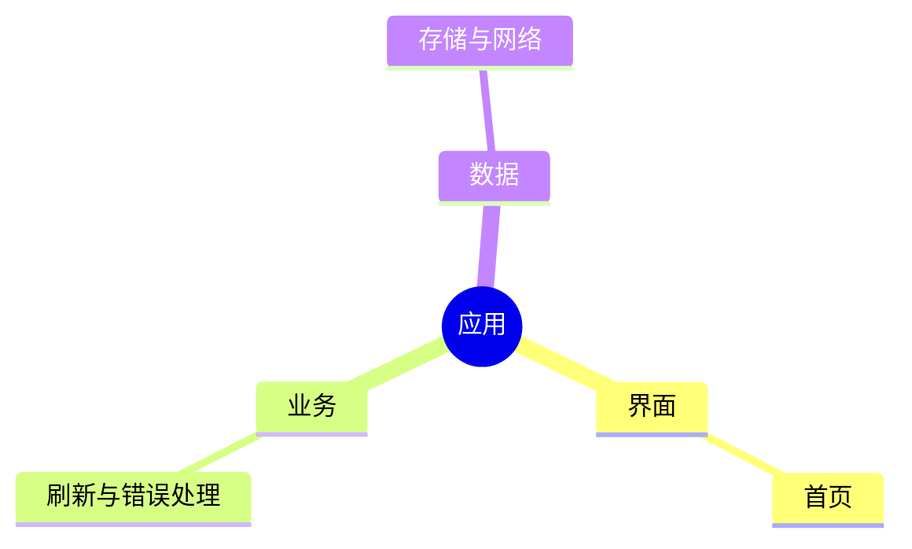

# ACEHarness 工作流看板

在**当前工作目录**的 `.board/` 下创建或更新 Markdown。ACEHarness 在工作台侧栏的「状态图」下显示「看板」。看板页可放置多份 Markdown，界面会将页名、文档引用和卡片布局保存到 `.board/layout.json`。现有看板页面的布局由用户调整和保存。

1. 查看项目结构、入口和模块职责。用图表达已有关系或用户明确要求的设计。
2. 每张看板写到 `.board/<名称>.md`。使用稳定文件名，直接放在 `.board/` 下。
3. 文件包含一个一级标题和一个标记为 `mermaid` 的代码块，或者一张使用普通 Markdown 语法引用的同目录图片。标题作为卡片名称，Mermaid 图由 Pele 渲染。
4. 模块地图优先使用 `mindmap`。需要表达方向、状态或调用顺序时，分别使用 `flowchart`、`stateDiagram-v2` 或 `sequenceDiagram`。节点标签尽量简明。
5. 使用纯文本标签及标准图语法。省略外部图片、链接、HTML、脚本、回调和工具渲染器专用扩展。
6. 完成后告知用户文件位置。运行记录使用该次运行的工作目录，工作流预览使用已配置的项目目录。

````markdown
# 应用模块图


````
